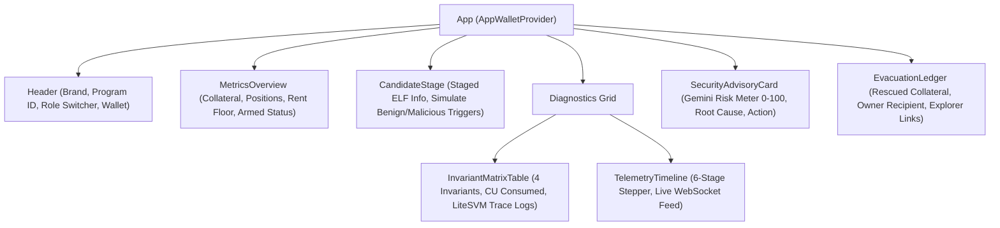

# ElfZero: Engineering Progress & State Checkpoint

**Date:** November 14, 2026  
**Branch:** `dev`  
**Current Milestone:** Phase 6 (Frontend UI Dashboard & Live Telemetry Feed) - Substeps 6.1 & 6.2 Complete

---

## 1. Executive Summary & Status

ElfZero is an Autonomous Upgradability Guardian and Program-Level Rollback Engine on Solana. It continuously monitors program upgrade buffers on-chain, replicates the proposed ELF bytecode into an isolated local LiteSVM environment, executes differential invariant sweeps against pre-upgrade state snapshots, and automatically triggers non-custodial emergency exits (`emergency_exit`) if invariant violations or unauthorized drains are detected.

### Phase 6 Progress Status:
- **Substep 6.1 Complete (`b11384c`):** Scaffolding & State Foundation:
  - Enterprise purple-on-white theme (`#FAFAFD` canvas, `#FFFFFF` cards, `#5B21B6`/`#6D28D9` royal violet accents, hairline borders `border-slate-200`).
  - Strict TypeScript definitions (`frontend/src/types/index.ts`).
  - Solana Wallet Adapter & Multi-Role Provider (`frontend/src/context/WalletProvider.tsx`).
  - Live Telemetry Hook with WebSocket listener & REST status polling (`frontend/src/hooks/useDashboardState.ts`).
  - Header & Role Switcher (`frontend/src/components/Header.tsx`).
  - Protocol Metrics Bar (`frontend/src/components/MetricsOverview.tsx`).
  - Candidate Staging & Attack Orchestration Card (`frontend/src/components/CandidateStage.tsx`).
- **Substep 6.2 Complete:** Core Diagnostic & Evacuation Components:
  - **Differential Invariant Matrix Table** (`frontend/src/components/InvariantMatrixTable.tsx`): 4-invariant status cards (`INV_RENT_FLOOR`, `INV_CONSERVATION`, `INV_UNAUTHORIZED_DRAIN`, `INV_NON_CUSTODIAL_EXIT`), dual-execution test vector comparison, CU tracking, expandable trace logs, and delta comparisons.
  - **Guardian Telemetry Timeline** (`frontend/src/components/TelemetryTimeline.tsx`): 6-stage pipeline progress checklist and live chronological event feed.
  - **AI Security Advisory Card** (`frontend/src/components/SecurityAdvisoryCard.tsx`): Google Gemini 2.5 Flash-Lite risk meter (0–100), technical root-cause analysis, economic risk assessment, and recommended action badge.
  - **Non-Custodial Evacuation Ledger** (`frontend/src/components/EvacuationLedger.tsx`): Autonomous rescue summary, position PDA, owner recipient wallet verification (`destination.key() == user_position.owner`), and Devnet Explorer links.
  - Fully wired in `frontend/src/App.tsx`.
  - Production build verified: `tsc && vite build` succeeded in 32s with 0 errors.

---

## 2. Phase 6 Frontend Architecture & Component Hierarchy



---

## 3. Verified Build Verification

```text
> elfzero-frontend@0.1.0 build
> tsc && vite build

vite v6.4.5 building for production...
transforming...
✓ 1866 modules transformed.
rendering chunks...
computing gzip size...
dist/index.html                   0.48 kB │ gzip:   0.32 kB
dist/assets/index-B9VKw93F.css   31.51 kB │ gzip:   6.74 kB
dist/assets/index-B8KtFABn.js   718.14 kB │ gzip: 217.96 kB
✓ built in 32.69s
```

---

## 4. Next Step: Phase 6.3 (Live Integration & End-to-End Verification)

- Boot backend server (`backend/src/index.ts`) in WSL Ubuntu on port 3001 (`http://localhost:3001` + `ws://localhost:3001`).
- Boot frontend development server (`frontend/`) on port 3000.
- Execute live verification:
  1. Trigger Benign V2: Verify 0 violations, green status, Risk Score 0, no evacuation dispatched.
  2. Trigger Malicious V2: Verify backdoor detection, Risk Score 98–100, autonomous evacuation of user collateral to owner wallet with real transaction link.
