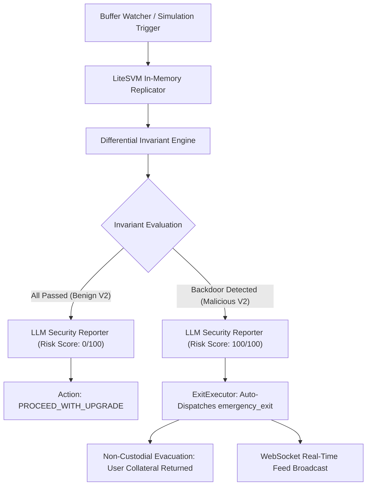

# ElfZero: Engineering Progress & State Checkpoint

**Date:** November 13, 2026  
**Branch:** `dev`  
**Current Milestone:** Phase 5 Complete (Autonomous Guardian Auto-Exit & Attack Orchestrator Verified)

---

## 1. Executive Summary & Status

ElfZero is an Autonomous Upgradability Guardian and Program-Level Rollback Engine on Solana. It continuously monitors program upgrade buffers on-chain, replicates the proposed ELF bytecode into an isolated local LiteSVM environment, executes differential invariant sweeps against pre-upgrade state snapshots, and automatically triggers non-custodial emergency exits (`emergency_exit`) if invariant violations or unauthorized drains are detected.

**Phase 5 is now fully completed:**
- **Substep 5.1 (`36eaba9`):** Autonomous Guardian Auto-Exit Executor (`backend/src/guardian/exitExecutor.ts` and `test_exitExecutor.ts`).
- **Substep 5.2:** Attack Simulator Orchestrator & Defense Pipeline (`backend/src/simulator/attackOrchestrator.ts`, `types.ts`, and `test_attackOrchestrator.ts`).
- **Backend API Integration:** Fully wired `backend/src/index.ts` with REST endpoints (`/api/status`, `/api/simulate/benign`, `/api/simulate/malicious`) and real-time WebSocket event streaming.
- **TypeScript Health:** Clean compile across all backend services (`pnpm exec tsc --noEmit` exits with code 0).

---

## 2. Phase 5 Architecture & Defense Pipeline



### Verified Test Results (End-to-End Orchestrator)
```text
=== ElfZero: Substep 5.2 Attack Orchestrator Verification ===

[Test 1] Running Benign V2 Simulation Pipeline:
  [Timeline] STAGE_PAYLOAD_DETECTED: vault_v2_benign.so (184,960 bytes, SHA-256: 2aa51e34...)
  [Timeline] STAGE_SANDBOX_INITIALIZED: Replicated candidate bytecode into LiteSVM sandbox.
  [Timeline] STAGE_DIFFERENTIAL_EVALUATION: Verdict = SAFE (0 violations found).
  [Timeline] STAGE_SECURITY_ADVISORY: Generated by gemini-2.5-flash-lite (Risk Score 0/100, Action: PROCEED_WITH_UPGRADE).
  [Timeline] STAGE_SIMULATION_COMPLETED: Finished with verdict: SAFE.
  Emergency Rescue Triggered: false

[Test 2] Running Malicious V2 Attack & Autonomous Defense Pipeline:
  [Timeline] STAGE_PAYLOAD_DETECTED: vault_v2_malicious.so (186,848 bytes, SHA-256: 46299c59...)
  [Timeline] STAGE_SANDBOX_INITIALIZED: Replicated candidate bytecode into LiteSVM sandbox.
  [Timeline] STAGE_DIFFERENTIAL_EVALUATION: Verdict = MALICIOUS_BACKDOOR_DETECTED (1 violation found).
  [Timeline] STAGE_SECURITY_ADVISORY: Generated by gemini-2.5-flash-lite (Risk Score 100/100, Action: Trigger immediate emergency exit).
  [Timeline] STAGE_EMERGENCY_RESCUE_TRIGGERED: EXPLOIT CONFIRMED: Autonomously dispatching Guardian Emergency Exit transactions...
  [Timeline] STAGE_EMERGENCY_RESCUE_TRIGGERED: Evacuated position: 2,000,000,000 lamports returned strictly to 5RL7Z7qJb4LDwQi5xoaXDsr93oK8MnRPVidBb3opRuNc.
  [Timeline] STAGE_EMERGENCY_RESCUE_TRIGGERED: Emergency evacuation completed: 1 position(s) rescued.
  [Timeline] STAGE_SIMULATION_COMPLETED: Finished with verdict: MALICIOUS_BACKDOOR_DETECTED.
>>> ALL SUBSTEP 5.2 ATTACK ORCHESTRATOR TESTS PASSED! <<<
```

---

## 3. Next Phase: Phase 6 (Frontend UI Dashboard & Live Telemetry Feed)

- **Phase 6.1:** Dashboard State Management & Solana Wallet Adapter integration.
- **Phase 6.2:** Real-Time Visual Components:
  - Header & Role Switcher (Authority / Guardian / User).
  - Protocol Metrics Bar (Total Collateral, Active Positions, Rent Exemption Floor, Guardian Status).
  - Live Upgrade Stage & Attack Simulator Trigger (Benign V2 vs Malicious V2 buttons).
  - Real-Time Defense Terminal & Timeline (Live WebSocket stream of simulation stages).
  - LLM Advisory Card (Gemini security assessments, vulnerability explanations, and risk meters).
  - Emergency Evacuation Panel (Real-time tracking of rescued user positions and transaction signatures).
