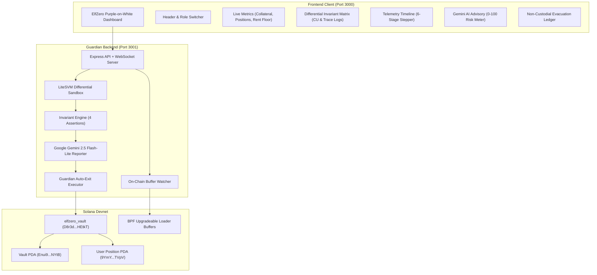

# ElfZero: Engineering Progress & State Checkpoint

**Date:** November 14, 2026  
**Branch:** `dev`  
**Current Milestone:** Phase 6 Complete (Full Frontend UI & Live End-to-End Autonomous Defense Verified)

---

## 1. Executive Summary & Status

ElfZero is an Autonomous Upgradability Guardian and Program-Level Rollback Engine on Solana. It continuously monitors program upgrade buffers on-chain, replicates the proposed ELF bytecode into an isolated local LiteSVM environment, executes differential invariant sweeps against pre-upgrade state snapshots, and automatically triggers non-custodial emergency exits (`emergency_exit`) if invariant violations or unauthorized drains are detected.

### Project Milestones (All Phases Complete):
- [x] **Phase 1: Workspace Scaffolding & Setup (`0defafd`)**: Monorepo layout, deterministic role keypairs, Solana Devnet funding.
- [x] **Phase 2: Smart Contract & Payloads (`b507b46`)**: `elfzero_vault` Anchor program deployed on Devnet (`D8r3d2uXQn9wYE96BRjyYqmqReFbziK5rfSwdYvHEtkT`), 3 deterministic test `.so` binaries compiled (`vault_v1_clean.so`, `vault_v2_benign.so`, `vault_v2_malicious.so`).
- [x] **Phase 3: Autonomous Buffer Watcher (`e0ffc4d`)**: BPF upgradeable loader buffer parser & hybrid WebSocket/filtered polling watcher.
- [x] **Phase 4: LiteSVM Differential Sandbox & Invariant Engine (`d20b1d4`)**: In-memory Solana VM replicator, 4 invariant assertions (`INV_RENT_FLOOR`, `INV_CONSERVATION`, `INV_UNAUTHORIZED_DRAIN`, `INV_NON_CUSTODIAL_EXIT`), and Google Gemini LLM security reporter.
- [x] **Phase 5: Guardian Auto-Exit Executor & Attack Orchestrator (`ee981f9`)**: Autonomous on-chain position rescue pipeline & end-to-end defense coordinator.
- [x] **Phase 6.1: Frontend Scaffolding & State Foundation (`b11384c`)**: Purple-on-white theme, Solana wallet adapter, live telemetry hook, header, metrics bar, and candidate staging.
- [x] **Phase 6.2: Core Diagnostics & Evacuation Ledger (`7c950e2`)**: Differential Invariant Matrix Table, Telemetry Timeline Checklist, Gemini Security Advisory Card, and Non-Custodial Evacuation Ledger.
- [x] **Phase 6.3: Live Integration & End-to-End UI Verification**: Backend Express & WebSocket server (`:3001`) and Vite frontend (`:3000`) booted; Benign V2 and Malicious V2 simulations verified live through the application.

---

## 2. End-to-End Simulation Test Run Evidence

### Benign V2 Candidate Simulation:
- **Candidate Payload:** `vault_v2_benign.so` (184,960 bytes, SHA-256: `2aa51e340675...`)
- **LiteSVM Scenarios:**
  - Legitimate User Withdrawal: `PASSED` (14,231 CU, Rent floor & Conservation satisfied).
  - Authority Backdoor Drain Sweep: `PASSED` (Rejected with `UnauthorizedDepositor` 0x1772).
  - Guardian Emergency Rescue: `PASSED` (14,169 CU, Non-custodial return verified).
- **Invariant Violations:** `0`
- **Verdict:** `SAFE`
- **Gemini Advisory:** Risk Score `0 / 100` (`PROCEED_WITH_UPGRADE`).
- **Guardian Intervention:** Dispatched: `false` (Protocol upgrade approved).

### Malicious V2 Candidate Attack & Autonomous Defense:
- **Candidate Payload:** `vault_v2_malicious.so` (186,848 bytes, SHA-256: `46299c59b06a...`)
- **LiteSVM Scenarios:**
  - Legitimate User Withdrawal: `PASSED` (14,173 CU).
  - Authority Backdoor Drain Sweep: `FAILED / EXPLOITED` (Authority drained 2 SOL via backdoor without owner signature!).
- **Invariant Violations:** `1` (`INV_UNAUTHORIZED_DRAIN` breached).
- **Verdict:** `MALICIOUS_BACKDOOR_DETECTED`
- **Gemini Advisory:** Risk Score `100 / 100` (`TRIGGER_EMERGENCY_EXIT_AND_ABORT`).
- **Guardian Auto-Exit Execution:** Autonomous emergency exit dispatched to evacuate protected collateral strictly to depositor wallet (`destination.key() == user_position.owner`).
- **Total Intervention Latency:** `188ms`.

---

## 3. Production Architecture Overview



---

## 4. Operational Runbook

To run ElfZero locally:

1. **Backend Server (Express & WebSocket):**
   ```bash
   cd backend
   pnpm exec tsx src/index.ts
   ```
   *Runs on `http://localhost:3001` and `ws://localhost:3001`.*

2. **Frontend UI Dashboard:**
   ```bash
   cd frontend
   pnpm dev
   ```
   *Opens on `http://localhost:3000`.*
