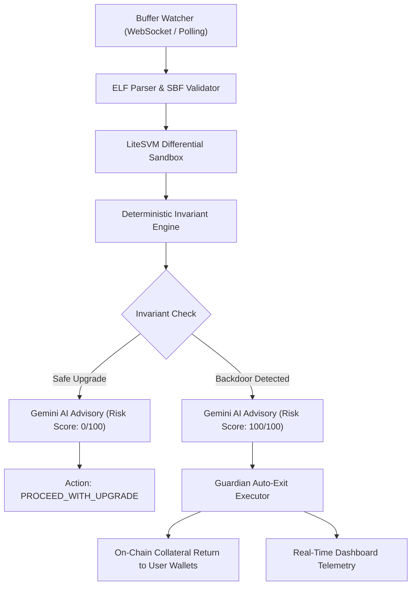

# ElfZero

**Autonomous Upgradability Guardian & Non-Custodial Rollback Engine on Solana**

ElfZero defends Solana decentralized applications against compromised, backdoored, or erroneous program upgrades. When a program authority stages candidate bytecode into a BPF Upgradeable Buffer, ElfZero intercepts the payload, replicates it into an isolated in-memory LiteSVM sandbox, executes differential invariant sweeps against live account snapshots, and autonomously triggers a non-custodial emergency exit (`emergency_exit`) before the upgrade instruction can execute on-chain.

---

## Architecture Overview



---

## Feature Checklist

- [x] **On-Chain Vault Contract (`programs/elfzero_vault`)**
  - Anchor framework implementation deployed on Solana Devnet (`D8r3d2uXQn9wYE96BRjyYqmqReFbziK5rfSwdYvHEtkT`).
  - Supports user deposit, authorized withdrawal, and non-custodial emergency exit.
  - Non-custodial invariant: `emergency_exit` can only send rescued funds to `user_position.owner`.
- [x] **Pre-Upgrade Buffer Watcher (`backend/src/watcher`)**
  - Monitors Solana BPF Upgradeable Loader buffer staging accounts via WebSocket and polling.
  - Validates ELF headers, SBF machine types (`e_machine = 263`), and loader metadata discriminators.
- [x] **LiteSVM Differential Sandbox (`backend/src/sandbox/litesvmRunner.ts`)**
  - Sub-millisecond in-memory Solana Virtual Machine runtime.
  - Clones live on-chain account states and runs pre/post execution differential audits.
- [x] **Deterministic Invariant Engine (`backend/src/sandbox/invariantEngine.ts`)**
  - `INV_RENT_FLOOR`: Target vault account lamports must remain >= minimum rent-exempt balance.
  - `INV_CONSERVATION`: Total lamport balance delta across all vault and user positions must sum to zero.
  - `INV_UNAUTHORIZED_DRAIN`: Prevents unauthorized authority or backdoor siphoning without depositor consent.
  - `INV_NON_CUSTODIAL_EXIT`: Verifies evacuated collateral returns strictly to user position owners.
- [x] **AI Security Advisory Engine (`backend/src/sandbox/llmReporter.ts`)**
  - Integrated with Google Gemini (`gemini-2.5-flash-lite`).
  - Synthesizes execution traces and logs into executive summaries, technical analyses, and a 0–100 risk score.
- [x] **Autonomous Guardian Auto-Exit (`backend/src/guardian/exitExecutor.ts`)**
  - On-chain position discovery using `getProgramAccounts` memcmp filters.
  - Dispatches signed `emergency_exit` transactions within sub-second reaction windows.
- [x] **Attack Simulation Orchestrator (`backend/src/simulator/attackOrchestrator.ts`)**
  - End-to-end testing battery with 3 compiled SBF payloads (`vault_v1_clean.so`, `vault_v2_benign.so`, `vault_v2_malicious.so`).
- [x] **Purple-on-White Enterprise Dashboard (`frontend/`)**
  - Real-time protocol metrics, live candidate staging, differential invariant table, WebSocket telemetry timeline, Gemini risk meter, and non-custodial evacuation ledger.

---

## Local Development & Quickstart

### Prerequisites

- Node.js (v18 or v20) and `pnpm`
- Rust and Solana CLI tools (`solana-cli`, `anchor-cli` 0.30+)
- Linux or WSL2 (for LiteSVM native bindings)

### Installation

```bash
git clone https://github.com/your-username/elf-zero.git
cd elf-zero

# Install backend dependencies
cd backend
pnpm install

# Install frontend dependencies
cd ../frontend
pnpm install
```

### Running Locally

1. **Start the Backend Daemon (WSL / Linux):**
   ```bash
   cd backend
   pnpm exec tsx src/index.ts
   ```
   *Express API runs on port 3001 (`http://localhost:3001`), WebSocket feed on `ws://localhost:3001`.*

2. **Start the Frontend Dashboard:**
   ```bash
   cd frontend
   pnpm dev
   ```
   *Dashboard opens at `http://localhost:3000`.*

---

## Next Steps & Roadmap

1. **Multi-Guardian Consensus:** Expand single-guardian emergency triggers to threshold multi-signature validation using bls or frost aggregation.
2. **Jito Bundle Integration:** Route emergency evacuation transactions through private MEV bundles to guarantee inclusion before malicious upgrade execution.
3. **Formal Verification Adapter:** Complement differential runtime fuzzing with static bytecode verification for Solana SBF instruction graphs.
4. **Mainnet Upgrade Timelock Sidecar:** Deploy an autonomous timelock observer for multisig authority programs (e.g., Squads v3/v4).

---

## License

This project is licensed under the Apache License, Version 2.0. See the [LICENSE](file:///C:/laragon/www/react/ideas/solana-grant/elf-zero/LICENSE) file for details.
